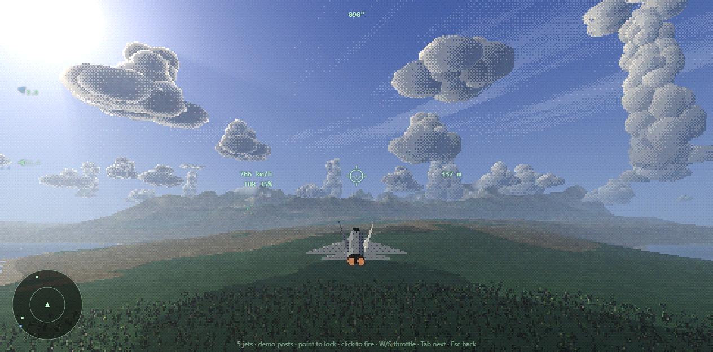
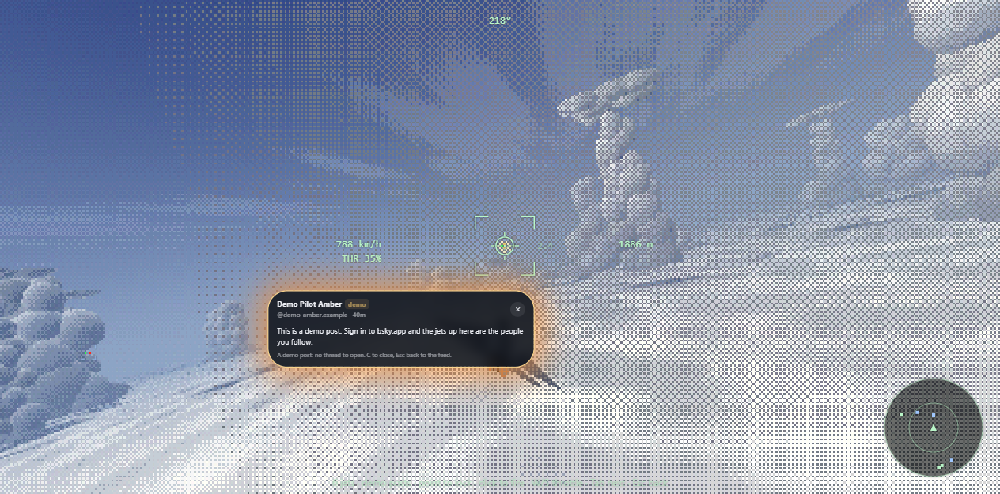

# fightskyone

A browser extension for [Bluesky](https://bsky.app): a PS1-style sky behind your feed, and a jet to fly in it. The other jets up there are posts from the people you follow. Point at one to lock on and see who posted it; click to send a missile, and the burst *is* the post, opening out of the explosion in a rounded card. Nobody gets hurt: the jet does a victory roll and flies on, its contrail turned blue so you know you've read it. More exploring than dogfighting.

A sibling of [skytreeone](https://github.com/TechyBen/tbsky) (a quiet forest behind Bluesky where posts are birds), from much higher up.





## Install (unpacked)

```bash
git clone https://github.com/TechyBen/fightskyone
```

Then in Chrome or Edge, open `chrome://extensions`, turn on **Developer mode**, click **Load unpacked** and pick the `ext` folder. Open bsky.app. There's no build step.

If skytreeone is installed too, switch one of them off in its popup: both put a scene behind the page.

## Flying

Click the little jet button at the bottom right of bsky.app (or **Fly** in the popup).

| | |
|---|---|
| Mouse | Steer: the jet turns toward the cursor (hold it off-centre to keep turning) |
| W / S | Throttle |
| A / D, arrow keys | Turn and climb, on top of the mouse |
| Point at a jet | Lock on (half a second); the lock box shows who posted it |
| Click or Space | Send a missile (unlocked, it just flies straight and puffs out) |
| Tab | Lock the next jet in view |
| Enter | Open the post's thread on Bluesky |
| C | Close the post card |
| Esc | Close the card, then back to your feed |

You can't crash: the jet pulls up by itself near the ground and the sea. Jets out of view get arrows at the edge of the screen; the radar (bottom left) shows everything within 9 km.

## The sky

- **Land**: one big grid that follows the camera, its heights from value noise in the vertex shader (the same noise in JS, so jets, trees and the camera agree with it). Coloured per pixel from the sky's palette ramps: patchwork fields with hedgerows, forest, rock, snow, beaches, and a sea with sun glints and surf. Below about 1.8 km, real [playtreeone](https://github.com/TechyBen/playtreeone) trees appear as baked impostor billboards.
- **Clouds**: cumulus as cauliflower stacks of low-poly puffs with flat bases, darker undersides, light in dithered steps, broken edges and a silver lining against the sun; tall towers with anvils; an undercast deck to fly over; thin cirrus streaks. They drift with the wind, cast moving shadows on the land and the jets, and fly through them for a soft whiteout. (After Eternal Plight's gas giant cloud puffs.)
- **Skies**: Clear Morning, Golden Hour, Above the Deck, Autumn Haze and Dusk Towers, changing behind a fade every few minutes (not while you're flying).
- **Look**: the playtreeone PS1 kit (vertex snapping, palette ramps with ordered dithering, height fog, low-res target with god rays and colour quantising, nearest-neighbour upscale).

## Sound

Only while flying (behind the feed the sky is silent), all synthesised with Web Audio, no samples: an engine that follows the throttle, wind that rises with speed and turning (with a random wobble so turns don't all sound the same) and goes muffled in cloud, jets whooshing past on their side, lock-on chirps, the missile's thump and hiss, a soft boom and a little F minor bell when a post bursts open, flare crackles.

The music is generated live too: 130 BPM in F minor, a syncopated FM bass line following Fm, Db, Ab, Eb, under a pad, with hats, a soft kick and a bell line coming and going in sections. Volume and music level are in the popup.

**Your own loop:** in the popup, **Your own MIDI loop…** reads a MIDI file and replays it note for note, at its own tempo, with the sky's instruments in place of the built-in bass line; the pad and bells follow its key. Only the notes are kept, in this browser's extension storage, and nothing is uploaded. Use loops you have the rights to; they never go in this repo (`local/` folders are git-ignored, and `?midi=local/loop.mid` plays one when testing the page on its own).

## The jets

- Your follow list comes from Bluesky's public API, and new posts from [Jetstream](https://github.com/bluesky-social/jetstream) filtered to those accounts (the last 3 hours replay on start). Each top-level post becomes a jet; up to 14 fly at once, new posts first, then older ones again round robin so the sky stays busy.
- Each jet is a low-poly delta-wing fighter painted in its author's profile picture colour (yours too), with contrails that thicken at altitude, nav lights and a strobe. They roam waypoints round you, keep clear of the ground, and head off after a few minutes.
- A hit opens the card: name, handle, time, text, up to four images, a link card or a video thumbnail. Enter sends Bluesky's own router to the thread without reloading the page, then the feed fades back in.

## Settings (toolbar popup)

| Setting | Default | |
|---|---|---|
| Sky behind Bluesky | on | Switching off restores Bluesky exactly |
| Jets from people I follow | on | |
| Sound while flying | on | Engine, wind and effects |
| Volume | 60% | |
| Music | 50% | |
| Your own MIDI loop | none | Replaces the built-in bass line; "Use built-in" switches back |
| Whose follows | blank | Blank uses the account signed in to bsky.app |
| Feed panel | 70% | Opacity of the blurred panel behind the feed |
| Blur | 6 px | |
| Minutes per sky | 12 | |
| Pixel height | 240 | Render height; lower is chunkier and lighter on the GPU |
| Frame cap | 30 fps | Behind the feed; fly mode runs at up to 60 |

## Files

- `ext/content.js`, `content.css`: the iframe behind bsky.app, the see-through panels and glass (as in skytreeone), the jet button, fly mode, opening threads.
- `ext/sky/`: the sky page. `main.js` (renderer, loop, shadows, messages), `terrain.js`, `noise.js`, `clouds.js`, `skies.js`, `jetmodel.js`, `craft.js` (shared flying), `flight.js` (your jet and the camera), `traffic.js` (post jets), `combat.js` (lock, missiles, bursts), `particles.js`, `hud.js`, `feed.js`.
- `ext/sky/ps1/`: the shared PS1 kit from playtreeone (as copied into Eternal Plight; keep in step), with its imports pointed at the vendored three.js.

## Testing without installing

```bash
python tools/serve.py
```

Then open `http://localhost:8201/sky/index.html?demo=1&fly=1` for made-up demo posts (they say so, and use their own storage), or `?jets=1&me=<handle>&fly=1` for someone's real follows. `sky=<id>` picks a sky. `window.fightsky` in the console has the parts.

To try the content script on bsky.app itself, inject `content.css`, then `settings.js` and `content.js` evaluated together, with `window.FIGHTSKY_TEST_BASE = 'http://localhost:8201/sky/index.html'` set first; `window.__fightskyTest.setFly(true)` flies.

## Licences

three.js (MIT, `licenses/`). The PS1 kit and trees are from playtreeone.
